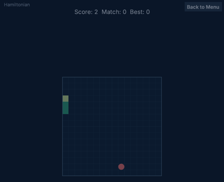
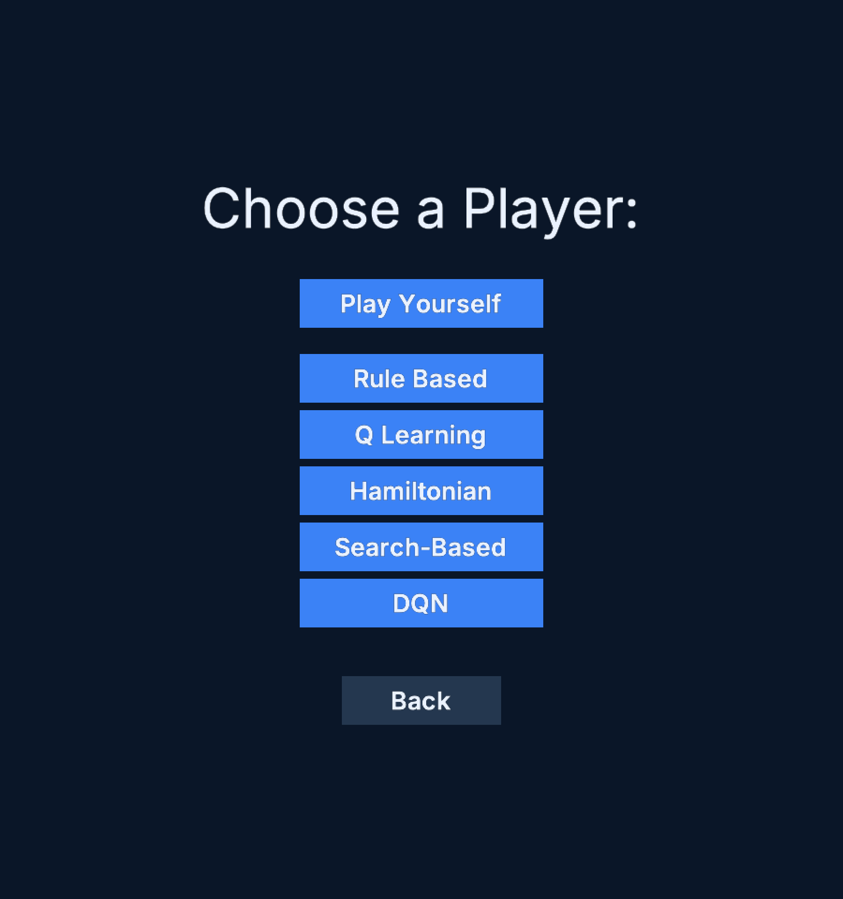
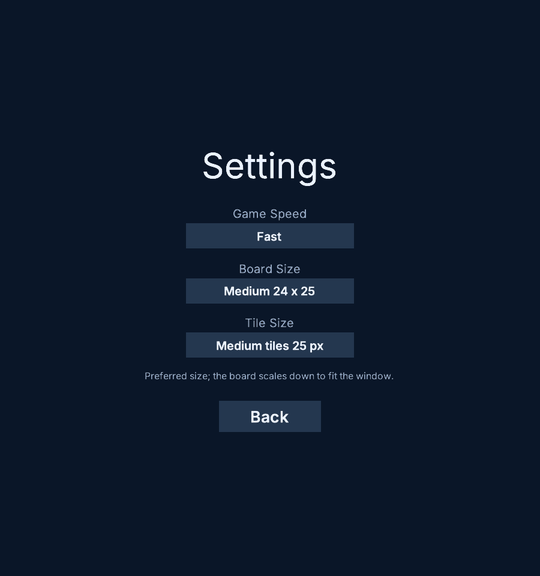
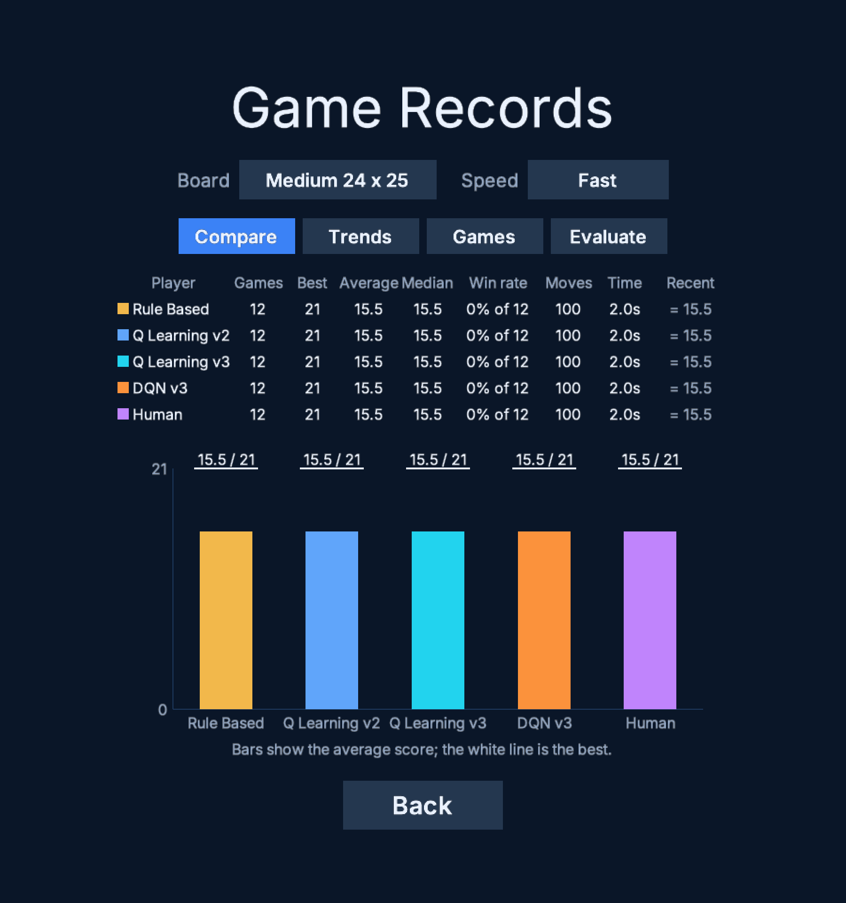
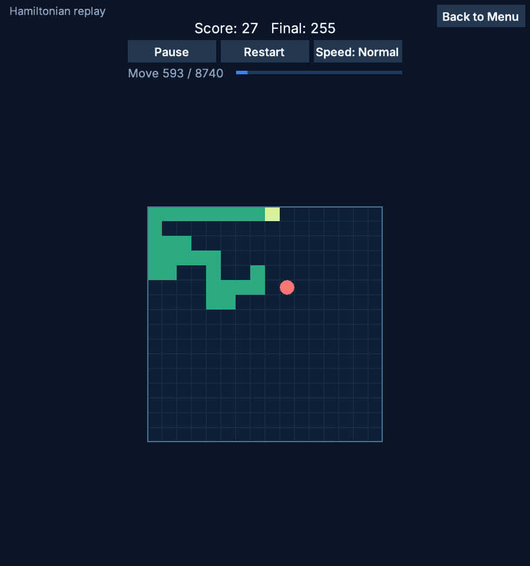
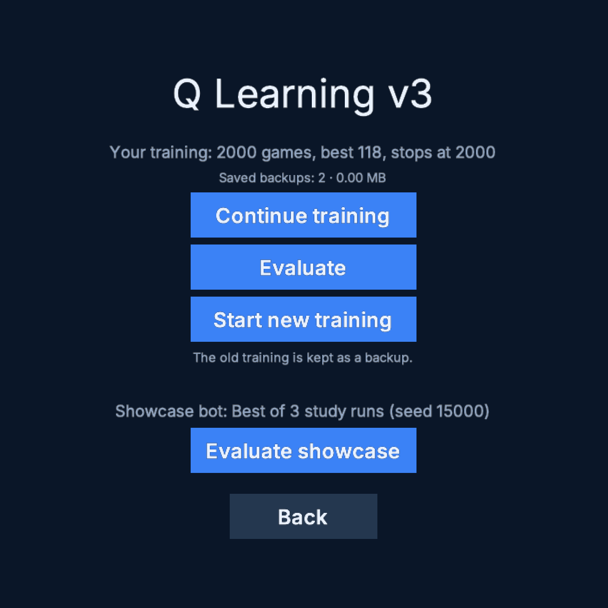
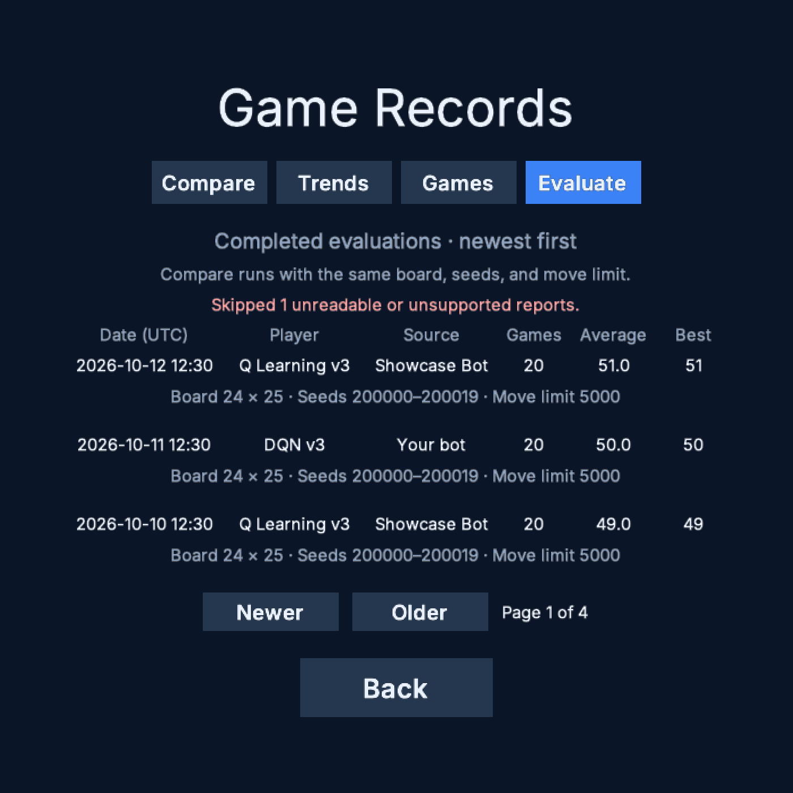
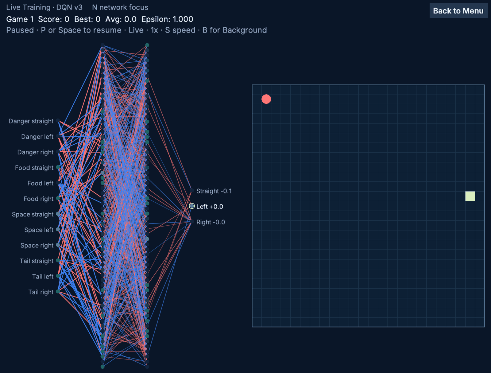

# Snake AI Project

A Python Snake game built with [Arcade](https://api.arcade.academy) 3. Play it
yourself, or watch AI bots play: hand-written rules, a search that plans ahead,
a route that covers the whole board, and Q Learning bots that learn from
experience. Records, replays, and repeatable experiments show how they compare.

<p align="center">
  
  <br>
  <em>The Hamiltonian bot winning a game on the 16 × 16 board.</em>
</p>

## Features

- **Human Play**: steer the snake yourself with the arrow keys or WASD.
- **Bot Modes**: Rule Based, Hamiltonian, Search-Based, Q Learning v2/v3,
  and optional DQN v2/v3.
- **App training**: continue or start new Q Learning and DQN training, with a
  game limit. DQN Live Training shows the board and network as it learns.
- **Evaluate**: measure your own bot or a bundled Showcase Bot on fixed games.
- **Records**: compare watched games by board and speed, and revisit completed
  app evaluations in a separate Evaluate tab.
- **Replays**: watch the best saved game of every Player, with pause, restart,
  and three speeds.
- **Settings**: game speed, board size, and tile size, in one resizable window.
- **Training and Bot Experiments**: train the learning bots and compare every
  bot on the same seeds, without opening the app.

## Quick Start

You need [Git](https://git-scm.com/downloads),
[uv](https://docs.astral.sh/uv/getting-started/installation/) (on macOS, for
example, `brew install uv`), and a desktop with a graphics driver,
because Arcade draws with OpenGL. Arcade supports macOS, Windows, and Linux.
The automated tests run on all three; the app window itself has so far been
checked by hand on macOS (see the
[smoke checklist](docs/arcade-smoke-checklist.md)).

```bash
git clone https://github.com/Hung-497/Snake.git
cd Snake
uv sync
uv run python SnakeApp.py
```

Without Git, use **Code → Download ZIP** on the GitHub page instead, unzip it,
and run the same commands from `cd Snake-main` onwards.

`uv sync` downloads Python 3.13 if needed, creates `.venv`, and installs the
exact versions in `uv.lock`. The other commands in this project start with
`uv run`, which runs them inside that environment.

## How to Play

The app opens one 900 × 960 window and moves between screens inside it. You can
resize the window; the board scales down to fit. The window size is not saved
between runs.

```text
Menu -> Play     -> Human / Rule Based / Hamiltonian / Search-Based
                -> Q Learning / DQN -> Choose a version -> Train or Evaluate
     -> Settings -> game speed, board size, tile size
     -> Replay   -> Choose a Player (and version for Q Learning / DQN)
     -> Records  -> Compare / Trends / Games / Evaluate
```

A bot plays one game after another by itself; use **Back to Menu** to stop.
Board size, tile size, and speed are saved automatically in the local
`settings.json` file and restored when the app starts again. Missing or
unreadable settings use the defaults; an unsupported choice falls back to its
default without discarding other valid choices. If saving fails, Settings
shows a message and the choices still apply until the app closes. The file
stays in the Snake folder and is not tracked by Git.

The speed names mean
different delays for bots and for you: bots move every 10, 5, or 1 ms on Slow,
Normal, or Fast, and Human Play moves every 150, 100, or 70 ms so you can
react.

### Human Play controls

Choose **Play Yourself** on the Play screen. The snake waits until you press
your first direction key, which can point any way.

| Key                  | Action                                                   |
| -------------------- | -------------------------------------------------------- |
| Arrow keys or WASD   | Steer. Two quick turns in a row are both kept.           |
| P or Space           | Pause or resume during a game                            |
| Space or Enter       | Play again after a game ends                             |
| Esc                  | Return to the menu                                       |

A key that would turn the snake straight back into itself is ignored. The game
also pauses when the window loses focus, and stays paused until you resume it.
A game you leave with Esc before it ends is not saved.

While watching a replay, P or Space pauses, R restarts, and S switches between
the Slow, Normal, and Fast Replay Speeds. The buttons on screen do the same.

### Screens

<table>
  <tr>
    <td></td>
    <td></td>
  </tr>
  <tr>
    <td align="center"><em>Choose who plays</em></td>
    <td align="center"><em>Settings</em></td>
  </tr>
  <tr>
    <td></td>
    <td></td>
  </tr>
  <tr>
    <td align="center"><em>Records: compare every Player</em></td>
    <td align="center"><em>Replay with playback controls</em></td>
  </tr>
</table>

## Training and Evaluate in the App

Choose **Play → Q Learning or DQN → v2 or v3**. The start screen offers
**Continue training**, **Evaluate**, and **Start new training** when you have
a readable save. With no save, you can start training or evaluate an available
Showcase Bot.

DQN needs the optional PyTorch dependencies. Keep the group selected when
running the app:

```bash
uv sync --group dqn
uv run --group dqn python SnakeApp.py
```

**Start new training** opens setup with a limit of Off, 1000, 2000, or 5000
games. Starting keeps the old save as a dated backup; the start screen shows
its backup count and total size. **Continue training** keeps the saved game
count and limit. At the limit, start a new run to train again.

Q Learning trains in the Game App View and saves after finished games. DQN
opens Live Training, with the network beside the board, and saves when you
leave or close the app. Each version has its own app save.

| Live Training control | Action |
| --- | --- |
| P or Space | Pause or resume |
| S | Cycle moves per frame |
| B | Switch Live / Background training |
| N | Toggle Network focus layout |
| Mouse wheel / drag / R | Zoom / pan / reset the focused network |
| Esc or Back to Menu | Leave and save progress |

**Evaluate** measures your saved bot without further learning.
**Evaluate showcase** measures a finished, read-only bot shipped with the app,
labelled as the best of three study runs. Showcase Bots are available for
Q Learning v2, Q Learning v3, and DQN v3; DQN v2 currently has none.

Choose **20 games** for a quick run or **200 games** for the full study set.
Evaluate always uses the 24 × 25 board, seeds starting at 200000, and a
5000-move limit, regardless of Settings. **W** switches between fast play and
watching. A completed run saves a JSON report; leaving early saves no report.

Open **Records → Evaluate** to revisit completed app runs. Rows show Your bot
or Showcase Bot, version, game count, average, best, and UTC date, with board,
seeds, and move limit underneath. Newer/Older pages through the history.
Watched training and Human Play games stay in Compare, Trends, and Games;
terminal experiments remain in their JSON files. Compare matching evaluation
conditions and keep the different sample sizes of 20- and 200-game runs clear.

<table>
  <tr>
    <td></td>
    <td></td>
  </tr>
  <tr>
    <td align="center"><em>Choose training or evaluation</em></td>
    <td align="center"><em>Revisit completed evaluations</em></td>
  </tr>
</table>

<p align="center">
  
  <br>
  <em>DQN Live Training, paused for inspection.</em>
</p>

These current screen captures use deterministic sample data; their displayed
scores illustrate the UI. See [Results](docs/results.md) for study measurements
and [Training the Learning Bots](docs/training.md) for detailed reproduction
steps. Recreate the screens with
`uv run --group dqn python tools/capture_app_views.py`; the
[smoke checklist](docs/arcade-smoke-checklist.md) explains the output and
visual checks.

## The Bots

| Bot | How it decides | How well it plays |
| --- | --- | --- |
| Rule Based | Follows a safe path to the food, else its tail, else the largest open space | Average score 13.9; may still trap itself (reference, no learning) |
| Search-Based | Searches future moves for food it can reach and still keep moving afterwards | Average score 38.0; plans ahead, but may still lose (reference, no learning) |
| Hamiltonian | Follows a route through every cell, taking safe shortcuts | Fills the board every time, but needs about 46,600 moves (reference, no learning) |
| Q Learning | Learns which move is best for each of the situations it can see (9 features) | Average score 43.6 |
| Q Learning v3 | Q Learning that also checks whether its tail stays reachable (12 features) | Average score 118.9 |
| DQN | A small neural network instead of a table, with either feature set; app Live Training or terminal commands | Average score 33.9 (v2), 136.2 (v3) |

The learning bots are the real comparison: each was trained for 2000 games,
then evaluated on the same 200 new games on the 24 × 25 board with a
5000-move limit. Rule Based, Search-Based, and Hamiltonian do not learn and
are shown only as reference points. Rule Based and Search-Based played the
same 200 games and always crashed well before the move limit; Hamiltonian
played 20 of them to the end and filled the board every time, but very
slowly. See [Results](docs/results.md) for the setup, the full results, and
their limitations.

## Run the Tests

```bash
uv run pytest
```

`uv sync` already installs pytest, because it is in the `dev` dependency
group. The DQN tests are skipped unless PyTorch is installed with
`uv sync --group dqn`. GitHub Actions runs every test, including the DQN tests,
on Linux, Windows, and macOS for pull requests and pushes to `main`.

## Check Python Code

Ruff checks the app and tests for unused imports, undefined names, and syntax
errors. It is installed with the development dependencies by `uv sync`.

```bash
uv run ruff check .
```

This local check preserves the current formatting style. It skips the virtual
environment and local agent worktrees. Tests still check behavior; Ruff only
checks the source code.

## Train and Compare Bots

Training and Bot Experiments run in the terminal without opening the app. The
two examples below use Q Learning v2, which needs a local Q-table. Copy the
bundled Starter Q-table once first. Comparing bots without Q Learning (for
example `--bots rule hamiltonian`) needs no table, and Q Learning v3 and DQN
are set up separately; see [Training the Learning Bots](docs/training.md).

On macOS or Linux:

```bash
mkdir -p learning_data
cp -n starter_data/q_table_space_state_v2.json learning_data/q_table_space_state_v2.json
```

On Windows (PowerShell; if your prompt does not start with `PS`, type `powershell` first):

```powershell
New-Item -ItemType Directory -Force learning_data
if (-not (Test-Path learning_data\q_table_space_state_v2.json)) { Copy-Item starter_data\q_table_space_state_v2.json learning_data\ }
```

Then train Q Learning for 100 games, or compare the bots on ten games with the
same seeds:

```bash
uv run python -m snake.sessions.TrainQLearning --games 100
uv run python -m snake.sessions.RunExperiment --games 10 --seed 7
```

The comparison takes about two minutes, mostly because Search-Based plans every
move. Add `--bots rule q_learning hamiltonian` to leave it out.

- [Training the Learning Bots](docs/training.md): Q Learning v2 and v3, the
  Training History, and DQN training, resuming, and evaluation.
- [Bot Experiments](docs/bot-experiments.md): choosing bots, adding DQN, and
  what each JSON report records.

Every finished evaluation (Evaluate in the app, `RunExperiment`, or
`EvaluateDQN`) rebuilds a Bot Report: a page with charts and a face-off between
any two bots in `reports/bot_report.html`, and the same numbers for agents in
`reports/bot_report.md`. Each saved run also gets its own run page in
`reports/runs/`, which compares that run's bots with every bot that played the
same games. Evaluate's Open report button (or R) opens the run page of the
evaluation that just finished, and the terminal commands print where both pages
are. To rebuild them by hand:

```bash
uv run python -m snake.sessions.AnalyseBots
```

See [Analyse saved experiments](docs/bot-experiments.md#analyse-saved-experiments)
for what it shows and for the committed Showcase Report.

## Where Your Data Is Saved

Games played in the app, by a bot or by you, save game records in `records/`
and each Player's best replay in `replays/`, for example
`replays/search_based_best.json`. Each record and replay names its Player: a
bot, or `human` for Human Play. Hamiltonian saves only games it wins. Q
Learning saves its app progress in `learning_data/q_table_app_v2.json` or
`q_table_app_v3.json`; terminal training uses separate tables. DQN Live Training
saves `learning_data/dqn_live_training.pt` (v3) or
`dqn_v2_live_training.pt` (v2). Start new training preserves dated backups.
Bot Experiments and completed app evaluations save reports in `experiments/`,
and Bot Reports are written to `reports/`.
Evaluation report identities keep the model hash and metadata, while full DQN
training-score history stays in its checkpoint. These folders hold local
Runtime Data that Git ignores, so a fresh clone starts with no records or replays.

## Project Structure

```text
SnakeApp.py          # Starts the app: the Arcade window and the App Views
snake/
  engine/            # SnakeEngine, GameConfig, GameTypes: board rules and state
  bots/              # BotMode, BotFactory, and the bots: Rule Based, Q Learning
                     # (v2 and v3), Hamiltonian, Search-Based, and DQN
  sessions/          # GameSession, ReplaySession, SessionSettings, HumanPlayer,
                     # PlayerFactory, and the TrainQLearning, TrainDQN,
                     # EvaluateDQN, RunExperiment, and AnalyseBots commands
  analysis/          # Bot Reports: reading saved experiments, statistics,
                     # charts, and the Markdown and HTML writers
  storage/           # Records, replays, DQN files, saved evaluation reports,
                     # and code version for reports
  ui/                # AppShell, Theme, WindowLayout, MotionRules, BoardRenderer,
                     # RecordsBrowser, Charts, and PlayerLabels
    views/           # Menu, Play, Settings, version/training setup, Game,
                     # Live Training, Evaluate, Replay, and Records App Views
tools/               # Local App View capture script and sample fixtures
tests/               # Automated tests (pytest)
docs/                # Training, Bot Experiments, Results, and decisions
assets/fonts/        # Bundled Inter font and its licence
img/                 # Screenshots and the GIF in this README
starter_data/        # Bundled Starter Q-table and read-only Showcase Bots
DEVLOG.md            # Development diary
```

`records/`, `replays/`, `learning_data/`, `experiments/`, and `reports/` are
created when you play, train, run Bot Experiments, or write a Bot Report.

## Documentation

- [Requirements](docs/requirements/requirements-engineering-v1/index.md): what
  the product must do, with acceptance criteria, starting from the
  [product definition](docs/requirements/product-definition.md)
- [Training the Learning Bots](docs/training.md)
- [Bot Experiments](docs/bot-experiments.md)
- [Results](docs/results.md) and the generated
  [Showcase Report](docs/results/showcase.md)
- [Architecture Decision Log](docs/adr/README.md): why the project is built the
  way it is
- [Arcade smoke checklist](docs/arcade-smoke-checklist.md): manual checks the
  automated tests cannot cover
- [Development diary](DEVLOG.md): the learning process, bugs, experiments, and
  results along the way

## License

This project is released under the [MIT License](LICENSE). The bundled Inter
font in `assets/fonts/` is not covered by it: it keeps its own
[SIL Open Font License](assets/fonts/Inter-LICENSE.txt).
