# Showcase Report

The Showcase Bots shipped with the app and the non-learning Baselines, each measured in Evaluation Mode on the same 200 study games. Built from 6 runs in 1 group of Experiment Conditions. Runs are only compared inside the same group.

Every number is computed from the saved games. The Move-limit rate is the share of games stopped by the move limit rather than ended by a win or a collision. Moves per point is how many moves the bot needed for each point of score; a high value with a high Move-limit rate suggests circling instead of chasing food.

Game by game compares two bots on the same seeds, so the luck of where the food appears cancels out. Each seed gives one difference in score, and the Average difference is their mean. The 95% range shows how far that average could move if the bots were tested on other seeds: when the whole range is above zero, the first bot reliably scores more; when it includes zero, the games cannot show a difference. A bot with several bot files uses its average score on each seed.

In each chart the line runs from the lowest to the best score, the box holds the middle half of the games, the line inside the box is the median, and the dot is the mean.

A bot file is the saved Q-table or DQN model, shown by the start of its hash. When the same bot file was evaluated more than once, only its newest run is shown. A combined row pools the games of every bot file of that bot.

Hamiltonian follows one route over the whole board, so it never collides, but filling the board takes far more than the study's 5000 moves. Its games stop at the move limit while the snake is still alive: its score shows how far that safe route gets in 5000 moves, not whether it can win.

## 24 × 25 board, 5000-move limit, seeds 200000–200199 (200 games)

| Bot | Bot file | Run date (UTC) | Games | Mean | Median | Best | Std dev | Win rate | Move-limit rate | Moves per point |
| --- | --- | --- | --- | --- | --- | --- | --- | --- | --- | --- |
| DQN v3 | 18b5932f | 2026-10-23 17:27 | 200 | 140.8 | 146.5 | 162 | 18.2 | 0.0% | 79.5% | 33.0 |
| Hamiltonian | — | 2026-10-23 17:27 | 200 | 122.5 | 123.0 | 132 | 3.9 | 0.0% | 100.0% | 40.8 |
| Q Learning v2 | 331d4d4a | 2026-10-23 17:27 | 200 | 44.1 | 44.0 | 87 | 14.8 | 0.0% | 0.0% | 24.3 |
| Q Learning v3 | 27fde16d | 2026-10-23 17:27 | 200 | 127.7 | 134.5 | 162 | 21.1 | 0.0% | 51.5% | 33.4 |
| Rule Based | — | 2026-10-23 17:27 | 200 | 13.9 | 13.0 | 37 | 9.4 | 0.0% | 0.0% | 16.5 |
| Search-Based | — | 2026-10-23 17:27 | 200 | 38.0 | 36.0 | 85 | 14.2 | 0.0% | 0.0% | 18.3 |

### Game by game

| Better bot | Compared with | Games | Average difference | 95% range | Verdict |
| --- | --- | --- | --- | --- | --- |
| DQN v3 | Q Learning v3 | 200 | 13.1 | 9.1 to 17.1 | DQN v3 scores more |
| DQN v3 | Hamiltonian | 200 | 18.3 | 15.6 to 20.9 | DQN v3 scores more |
| DQN v3 | Q Learning v2 | 200 | 96.7 | 93.5 to 99.9 | DQN v3 scores more |
| DQN v3 | Search-Based | 200 | 102.8 | 99.5 to 106.1 | DQN v3 scores more |
| DQN v3 | Rule Based | 200 | 126.9 | 124.1 to 129.8 | DQN v3 scores more |
| Q Learning v3 | Hamiltonian | 200 | 5.2 | 2.3 to 8.1 | Q Learning v3 scores more |
| Q Learning v3 | Q Learning v2 | 200 | 83.6 | 79.9 to 87.3 | Q Learning v3 scores more |
| Q Learning v3 | Search-Based | 200 | 89.7 | 86.2 to 93.3 | Q Learning v3 scores more |
| Q Learning v3 | Rule Based | 200 | 113.9 | 110.5 to 117.2 | Q Learning v3 scores more |
| Hamiltonian | Q Learning v2 | 200 | 78.4 | 76.3 to 80.5 | Hamiltonian scores more |
| Hamiltonian | Search-Based | 200 | 84.5 | 82.5 to 86.6 | Hamiltonian scores more |
| Hamiltonian | Rule Based | 200 | 108.7 | 107.2 to 110.2 | Hamiltonian scores more |
| Q Learning v2 | Search-Based | 200 | 6.2 | 3.5 to 8.8 | Q Learning v2 scores more |
| Q Learning v2 | Rule Based | 200 | 30.3 | 27.9 to 32.7 | Q Learning v2 scores more |
| Search-Based | Rule Based | 200 | 24.1 | 21.9 to 26.4 | Search-Based scores more |

### Where each bot came from

| Bot | Bot file | Feature Set | Games trained | Trained by | Training seeds | Code |
| --- | --- | --- | --- | --- | --- | --- |
| DQN v3 | 18b5932f | v3 | 2000 | Terminal command | 9000 | 1b597fe |
| Hamiltonian | — | — | — | — | — | 1b597fe |
| Q Learning v2 | 331d4d4a | v2 | 2000 | unknown | 12000 | 1b597fe |
| Q Learning v3 | 27fde16d | v3 | 2000 | unknown | 15000 | 1b597fe |
| Rule Based | — | — | — | — | — | 1b597fe |
| Search-Based | — | — | — | — | — | 1b597fe |
